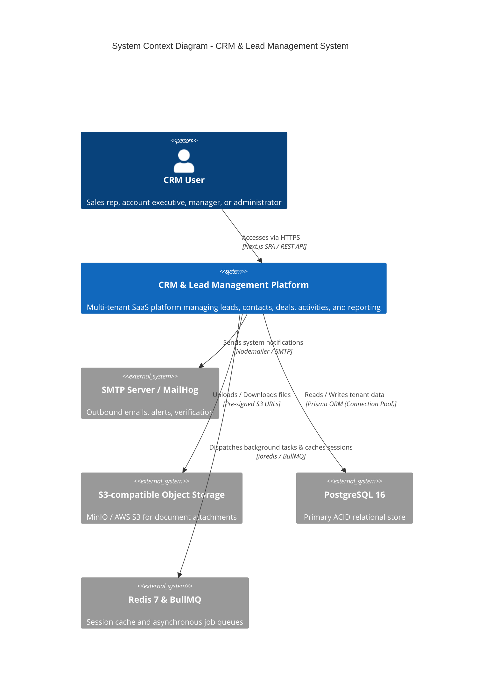
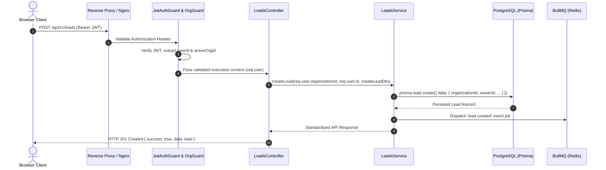

# High-Level Architecture & Technical Specification

This document details the architectural foundation, design principles, modular structure, and interaction patterns of the **CRM & Lead Management System**.

---

## 1. System Context & C4 Architecture



---

## 2. Monorepo Structure

```
crm-system/
├── apps/
│   ├── api/                   # NestJS Application (REST API, Swagger, BullMQ)
│   │   ├── src/
│   │   │   ├── common/        # Guards, Interceptors, Filters, Pipes, Decorators
│   │   │   ├── config/        # Environment config schema (Joi / Zod)
│   │   │   ├── modules/       # Domain modules (Auth, Leads, Deals, Activities, etc.)
│   │   │   ├── app.module.ts
│   │   │   └── main.ts
│   │   ├── test/              # E2E & unit test suites
│   │   └── package.json
│   │
│   └── web/                   # Next.js App Router (React, Tailwind CSS, shadcn/ui)
│       ├── src/
│       │   ├── app/           # App router layouts and pages
│       │   ├── components/    # Reusable UI library (Tables, Modals, Badges, Charts)
│       │   ├── hooks/         # Custom React hooks (useAuth, useLeads, useDebounce)
│       │   ├── lib/           # API client (Axios/Ky), formatting, validation
│       │   └── types/         # Client-specific interfaces
│       └── package.json
│
├── packages/
│   ├── database/              # Prisma schema, migrations, generated client, and seeds
│   │   ├── prisma/
│   │   │   ├── schema.prisma
│   │   │   └── seed.ts
│   │   └── package.json
│   │
│   └── shared-types/          # Shared DTOs, Enums, API contracts, and validation
│       ├── src/
│       │   ├── enums/
│       │   ├── dtos/
│       │   └── index.ts
│       └── package.json
│
├── docker/                    # Docker Compose & container configurations
├── docs/                      # Architecture, threat model, API specs, and guides
└── package.json               # Monorepo root
```

---

## 3. Technology Stack Justification

| Layer | Selected Tech | Architecture Rationale |
|---|---|---|
| **Frontend Framework** | **Next.js 14+ (App Router)** | Server Components for optimal initial render, client components for rich interactive dashboards, optimized font/image loading. |
| **Styling & Components** | **Tailwind CSS + shadcn/ui** | Highly modular, accessible UI primitives (Radix UI) styled with consistent design tokens and dark mode support. |
| **Backend Framework** | **NestJS (TypeScript)** | Enterprise-grade modular architecture with native dependency injection, decorators, middleware, and OpenAPI generator. |
| **Database & ORM** | **PostgreSQL 16 + Prisma** | Strict ACID transactional compliance, foreign key cascade constraints, JSONB column support, and type-safe query generation. |
| **Caching & Queues** | **Redis 7 + BullMQ** | High-throughput asynchronous job execution for email notifications, CSV imports, and event-driven automation rules. |
| **Object Storage** | **S3-compatible (MinIO / AWS S3)** | Secure, pre-signed URL workflow ensuring zero binary streaming through API servers. |
| **API Specification** | **OpenAPI 3.0 / Swagger** | Automatically generated interactive documentation accessible at `/api/docs`. |

---

## 4. Multi-Tenant Request Lifecycle


