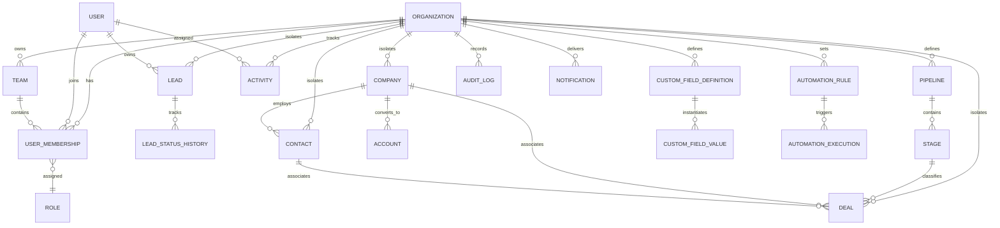

# Database Architecture & Data Model

This document outlines the entity relationship design, constraints, indexing strategies, and normalization principles used in the PostgreSQL database.

---

## 1. Entity-Relationship Diagram (ERD)

---

## 2. Core Entities & Schema Design

### Multi-Tenancy & Access Control
- **`Organization`**: The top-level tenant entity. Stores organization name, slug, billing plan, currency, timezone, logo, and metadata.
- **`User`**: Global user entity representing credentials (email, password hash, phone, avatar, verification status).
- **`Membership`**: Relational bridge between `User` and `Organization`. Defines tenant-scoped roles (`OWNER`, `ADMIN`, `MANAGER`, `SALES_REP`, `READ_ONLY`), title, department, and active status.
- **`Role` & `Permission`**: Granular role-based capability table (e.g. `leads:read`, `leads:write`, `deals:delete`, `reports:export`).
- **`Team`**: Grouping of memberships within an organization for group assignment and visibility rules.

### Sales & Lead Lifecycle
- **`Lead`**: Prospects and unqualified opportunities. Includes source (`WEBSITE`, `REFERRAL`, `COLD_OUTREACH`, `PAID_AD`, `EVENT`), status (`NEW`, `CONTACTED`, `QUALIFIED`, `UNQUALIFIED`, `CONVERTED`, `LOST`), priority (`LOW`, `MEDIUM`, `HIGH`, `URGENT`), score (0-100), estimated value, owner ID, and conversion timestamp.
- **`LeadStatusHistory`**: Immutable log recording every lead status change with author, timestamp, previous status, next status, and note.
- **`Company`**: B2B organization records. Industry, employee headcount, annual revenue, domain, address, and phone.
- **`Contact`**: Individual humans associated with companies or deals. First name, last name, email, phone, job title, and decision-maker status.
- **`Account`**: Companies converted to active paying customers with tier, customer health score, and dedicated account manager.

### Pipeline & Deal Management
- **`Pipeline`**: Customizable sales funnel pipelines (e.g. "Standard Sales Pipeline", "Enterprise Deals", "Renewal Pipeline").
- **`Stage`**: Ordered stages within a pipeline with win probability (0-100%) and SLA duration.
- **`Deal`**: Opportunity records with monetary amount, currency, expected close date, probability, won/lost state, and lost reason.

### Productivity & Collaboration
- **`Activity`**: Polymorphic task/interaction record. Types: `TASK`, `CALL`, `MEETING`, `EMAIL`, `NOTE`. Relates to `Lead`, `Contact`, `Company`, or `Deal`.
- **`FileAttachment`**: S3-backed uploaded documents, proposal PDFs, and contracts.

### Extensibility & Operations
- **`CustomFieldDefinition`**: Tenant-defined custom fields for `LEAD`, `CONTACT`, `COMPANY`, or `DEAL`.
- **`CustomFieldValue`**: Dynamic JSON/value storage linked to entity IDs.
- **`AutomationRule` & `AutomationExecution`**: Trigger-action rule definitions and execution audit records.
- **`AuditLog`**: Tamper-proof log of user mutations with IP, user-agent, entity, and diff snapshot.
- **`Notification`**: In-app notifications with read status and deep-link actions.

---

## 3. Indexing & Query Optimization Strategy
1. **Tenant Prefixing**: Every tenant table indexes `(organizationId, id)` and `(organizationId, createdAt)`.
2. **Search Indexes**: B-Tree and GIN indexes on `(organizationId, email)` and `(organizationId, companyName)`.
3. **Pipeline Filtering**: Composite index on `(organizationId, pipelineId, stageId, status)`.
4. **Activity Calendars**: Index on `(organizationId, assignedToId, dueAt, status)`.
