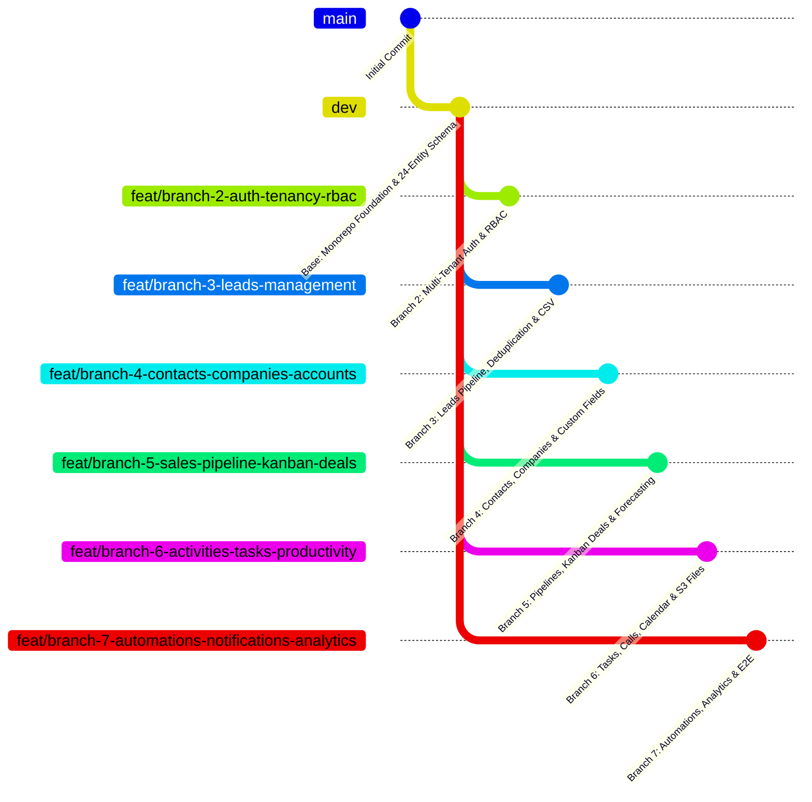

# 7-Branch Phased Implementation Roadmap & Verification Matrix

This document defines the 7-branch architectural roadmap for building the multi-tenant **CRM & Lead Management System**. All branches are based on the primary development branch: **`dev`**.

---

## 7-Branch Overview (Base Branch: `dev`)



---

## 7 Branches Release Matrix

| Branch # | Branch Name | Base Branch | Primary Deliverables / Scope | Status |
|---|---|---|---|---|
| **Branch 1** | **`dev`** (or `feat/branch-1-foundation-data-model`) | `origin` | Monorepo scaffolding, PostgreSQL 16 Docker, 24-model Prisma Schema, `@crm/shared-types`, `@crm/database`, STRIDE Threat Model, OpenAPI Specs. | **TODAY (READY TO PUSH)** |
| **Branch 2** | `feat/branch-2-auth-tenancy-rbac` | `dev` | Multi-tenant Organization onboarding, User registration & login, password hashing, JWT access + Redis refresh token rotation, RBAC roles (`OWNER`, `ADMIN`, `MANAGER`, `SALES_REP`, `READ_ONLY`) & guards, Auth shell UI. | Planned |
| **Branch 3** | `feat/branch-3-leads-management` | `dev` | Complete Lead CRUD, search/filter/pagination, duplicate detection engine, atomic conversion (Lead → Contact + Company + Deal), CSV import/export with column mapper, status history timeline. | Planned |
| **Branch 4** | `feat/branch-4-contacts-companies-accounts` | `dev` | Contacts & Companies relational directory, Account 360 View, dynamic custom fields engine (`TEXT`, `NUMBER`, `DATE`, `SELECT`), owner assignments. | Planned |
| **Branch 5** | `feat/branch-5-sales-pipeline-kanban-deals` | `dev` | Multi-pipeline management, interactive HTML5 drag-and-drop Kanban board, deal amounts, win/loss validation, and weighted revenue forecasting. | Planned |
| **Branch 6** | `feat/branch-6-activities-tasks-productivity` | `dev` | Polymorphic activities (Tasks, Calls, Meetings, Notes), calendar & list views, overdue reminder alerts, S3 pre-signed document attachments. | Planned |
| **Branch 7** | `feat/branch-7-automations-notifications-analytics` | `dev` | BullMQ background workers, event triggers (auto-assign round-robin), in-app notification center, real SQL-aggregated dashboard charts, reports export, Docker & E2E hardening. | Planned |

---

## Daily Branch Push Workflow

1. Base branch is **`dev`**.
2. Each day a new branch is created off `dev`:
   ```bash
   git checkout dev
   git pull origin dev
   git checkout -b feat/branch-N-<feature-name>
   ```
3. Implement and verify the phase features.
4. Commit with conventional commit messages.
5. Push to GitHub:
   ```bash
   git push -u origin feat/branch-N-<feature-name>
   ```
